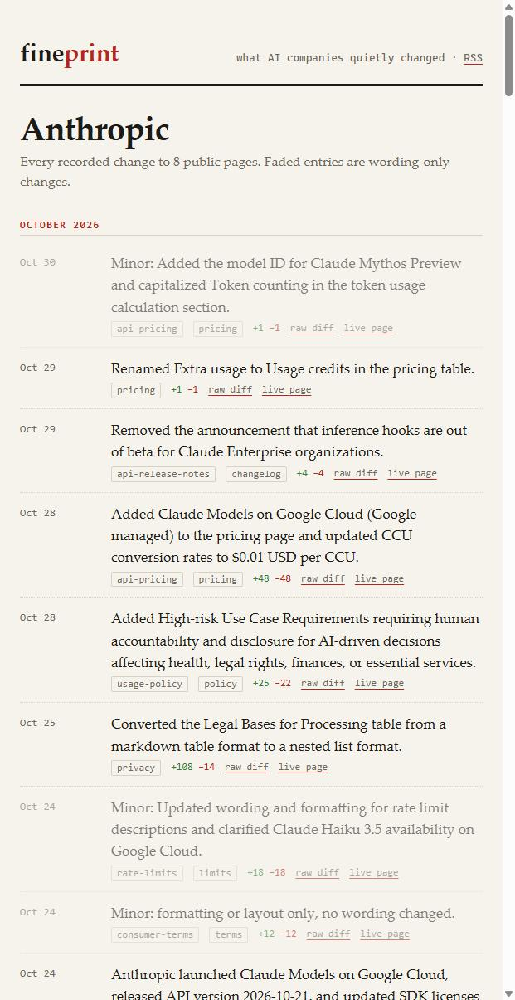

# fineprint

**`git log` for what AI companies quietly changed.**

fineprint snapshots the public pricing, rate-limit, usage-policy, terms, privacy,
model-deprecation and changelog pages of AI vendors, normalizes each one to stable
markdown, and commits it. The git history *is* the archive: every commit is a dated,
reviewable diff. A local LLM writes one plain-English line per diff, and every line
links the raw diff, so you never have to trust the model.

**Browse it:** [dadwritestech.github.io/fineprint](https://dadwritestech.github.io/fineprint/), with a timeline per vendor and an [RSS feed](https://dadwritestech.github.io/fineprint/feed.xml). It is refreshed every 6 hours.

## Six quiet changes from the last six months

None of these had a blog post. Each date is the first weekly sample that showed the change, and each link opens the raw diff.

| Seen | Vendor | What changed |
|---|---|---|
| 2026-05-15 | Google | Grounding with Google Search: the free tier went from *"Free of charge, up to 1500 RPD"* to *"Not available"*. The paid allowance went from 5,000 per **day** to 5,000 per **month**. [diff](https://dadwritestech.github.io/fineprint/diffs/083c89d8d0-google-gemini-api-pricing.html) |
| 2026-05-20 | xAI | Text-to-speech went from $4.20 to $15.00 per 1M characters (3.6×). [diff](https://dadwritestech.github.io/fineprint/diffs/47028293d0-xai-models-pricing.html) |
| 2026-07-02 | GitHub Copilot | The *"Data excluded from training by default"* row disappeared from the plan comparison. [diff](https://dadwritestech.github.io/fineprint/diffs/a0b093fb59-github-copilot-plans.html) |
| 2026-09-25 | Mistral | Commercial terms: the right to object to an update was replaced by *"sole and exclusive remedy is to stop using"* the products. [diff](https://dadwritestech.github.io/fineprint/diffs/2b9186f701-mistral-terms.html) |
| 2026-10-05 | Cursor | Privacy policy: the line *"We do not 'sell' or 'share' personal data for cross-contextual behavioral advertising"* was removed. [diff](https://dadwritestech.github.io/fineprint/diffs/3cdd5227d2-cursor-privacy.html) |
| 2026-10-28 | Google | Gemini API, paid tier: new projects now *"store requests by default (`store=true`)"*. [diff](https://dadwritestech.github.io/fineprint/diffs/e426025c2c-google-gemini-api-changelog.html) |



Summary accuracy, hand-checked on a seeded sample: **27/30**. There were no invented numbers in the sample, but one known price misreading exists outside it. See [docs/spotcheck.md](docs/spotcheck.md).

- `snapshots/<vendor>/<page>.md`: the current text of each page
- `git log -p -- snapshots/openai/usage-policies.md`: its full history
- `site/`: a static timeline per vendor, plus `site/feed.xml` (RSS)
- `data/changes.jsonl`: one record per change (date, page, summary, +/- lines, diff path)

## What is watched

46 public, logged-out pages across 10 vendors: Anthropic, OpenAI, Google Gemini, xAI,
Mistral, Cursor, GitHub Copilot, Perplexity, DeepSeek and Groq. See [`pages.toml`](pages.toml).
Pages behind a login are out of scope.

## How it works

```
fetch (robots.txt-checked, >=6 s per host)  ->  normalize  ->  commit if changed
                                                           ->  summarize diff (LLM)  ->  site + RSS
```

**Normalize** (`fineprint/normalize.py`) turns HTML into markdown built for diffing, not reading.
It drops scripts, styles, nav/header/footer, forms, cookie banners, screen-reader-only text,
"was this helpful" widgets, relative timestamps ("3 hours ago") and copyright lines. It also
drops link targets and images, because URLs churn (tracking params, CDN hashes, locales).
It folds NBSP, zero-width characters and curly quotes, and decodes Cloudflare-obfuscated
emails. Absolute dates like "Last updated: May 1, 2026" are kept on purpose: a vendor
bumping that date is itself news. `tests/test_normalize.py` checks that each kind of noise
produces a byte-identical snapshot, and that real edits (a price, a quota, a removed bullet)
still produce a diff.

**Summaries** (`fineprint/summarize.py`) first cancel removed/added line pairs that differ
only in markup (e.g. `##` became `###`). If nothing else is left, the change is labelled
"Minor: formatting" with no LLM call. Otherwise the condensed diff goes to an
OpenAI-compatible endpoint (default: a local llama-server running gemma-4-12b). Lines the
model marks `Minor:` are faded on the site and left out of RSS.

**Backfill** (`python -m fineprint backfill 20260430 20261030`) rebuilds history from the
Wayback Machine. It uses the CDX API, about one capture per week per page, `id_` raw
captures, 3 s between archive.org requests, and backoff on 429/5xx. Captures that are bot
walls, JS shells, undecodable bytes, or under half the size of both neighbouring captures
are dropped. So are one-capture "blips" (A, B, A): a stale CDN copy would otherwise make two
false headlines. Every drop is listed in `data/backfill-report.json`. Live runs get the same
protection differently: a change must be seen on two consecutive fetches before it is
committed, dated to when it was first seen (`data/pending.json`). Backfilled dates mean "first seen in a weekly
sample", not the exact change time.

## Run it

```bash
pip install -r requirements.txt
python -m pytest -q tests
python -m fineprint fetch          # live snapshot of every page, one commit per changed page
python -m fineprint summarize      # needs LLAMA_API_KEY / FINEPRINT_LLM_* (or --no-llm)
python -m fineprint build          # writes site/ and site/feed.xml
```

The GitHub Actions workflow (`.github/workflows/fineprint.yml`) runs this every 6 hours.
It stays inert until the repository variable `FINEPRINT_ENABLED` is `true`.

## Caveats

- Summaries come from a 12B local model. Read the diff before you quote a summary.
- Some vendors A/B test or geo-target pages. A diff can reflect what our fetcher was shown,
  not a global change.
- When a vendor moves a page (e.g. docs.anthropic.com to platform.claude.com), the first
  snapshot after the move often has a large layout diff.

## Contributing

Want a page watched? Add it to [`pages.toml`](pages.toml) and open a PR (see [CONTRIBUTING.md](CONTRIBUTING.md)). Found a summary that is wrong? Open an issue with its diff link; the diff is the source of truth.

## License

- **Code:** [Apache-2.0](LICENSE).
- **Data** (`data/`, the site, summaries, reports): [CC BY 4.0](DATA_LICENSE). Reuse it anywhere; credit "fineprint by dadwritestech" with a link, or cite [CITATION.cff](CITATION.cff).
- **Snapshots** (`snapshots/`, quoted lines in `site/diffs/`): the vendors' own text, kept for review and reporting. It is not ours to license. See [NOTICE-SNAPSHOTS.md](NOTICE-SNAPSHOTS.md).

Also by dadwritestech: [token-tax](https://github.com/dadwritestech/token-tax), which shows what the same text costs in 48 languages on 21 tokenizers.
